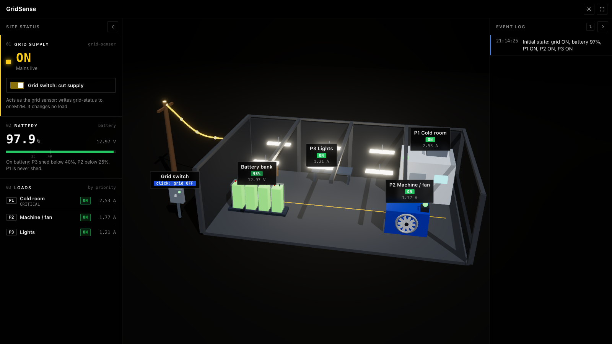
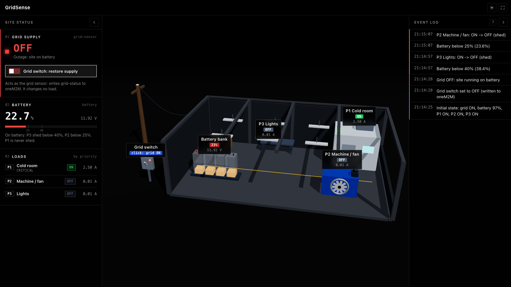
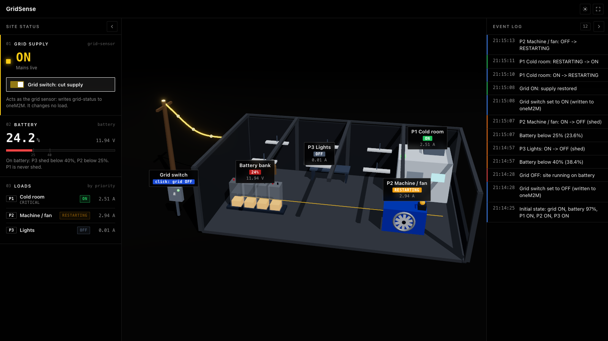
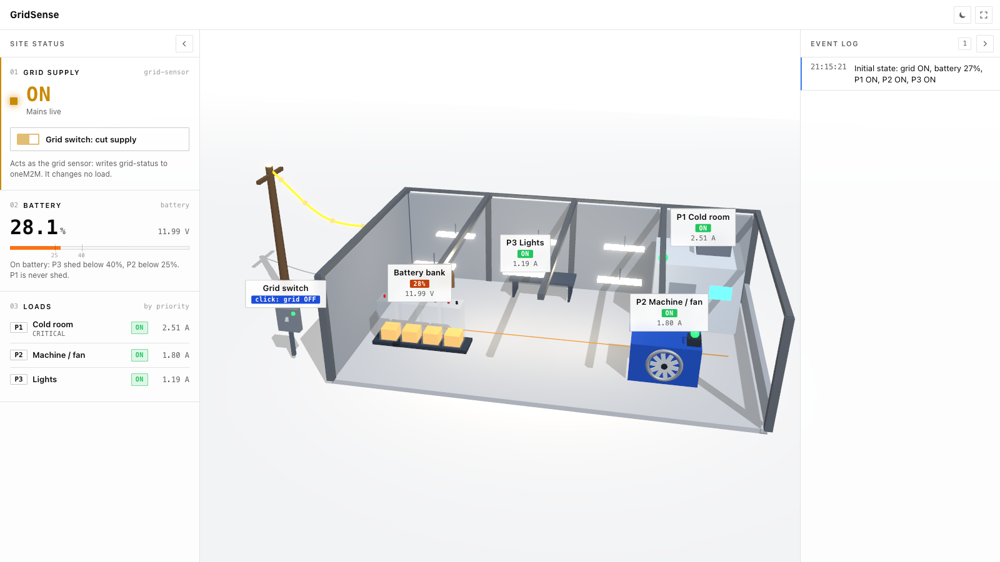

# Dashboard

Web dashboard with a 3D virtual factory that shows the GridSense site live from oneM2M. The devices are "installed" in the virtual factory, which replaces a physical site in the demo video. It renders what is stored in oneM2M and makes no decisions.

- Tier: Cloud (application layer, see [docs/architecture.md](../docs/architecture.md))
- Language: TypeScript, Next.js 16 (App Router), React Three Fiber + drei, built from primitives only (no external 3D assets, no web fonts)
- Status: first version. Runs in the Compose stack and was tested end to end with the dev feed on 2026-10-14.



## How it reads oneM2M

The browser never calls Mobius4 or ACME and never sees an originator. It polls the dashboard's own API once per second; the API's route handlers talk oneM2M over HTTP, server-side:

```text
browser --/api/state, /api/grid--> dashboard server --oneM2M HTTP--> Mobius4 (IN-CSE) --forwards--> ACME (site MN-CSE)
```

- Read path: through Mobius4, SP-relative `http://mobius4:7599/~/id-mn/cse-mn/...`, which Mobius4 forwards to ACME. Verified working. Mobius4 forwards with the originator rewritten to `/Mobius4/<originator>`, so the ACP on ACME names both forms ([docs/cse-setup.md](../docs/cse-setup.md), Fix 5). To read ACME directly instead, set `ONEM2M_BASE_URL=http://acme-site:8081`.
- Each snapshot reads the latest `<contentInstance>` (`/la`) of the five containers in [docs/resource-tree.md](../docs/resource-tree.md). The server shares one read per 0.9 s across all browser tabs, because Mobius4 rate-limits each client IP (500 requests per minute).
- Requests carry `X-M2M-Origin`, a unique `X-M2M-RI`, `X-M2M-RVI: 3`, and `Content-Type: application/json;ty=4` on creates. The helper is `lib/onem2m.ts` (no dependencies; meant to move to `libs/onem2m` later).
- Live updates are polling for now. oneM2M `<subscription>` notifications are a planned improvement.

### API

`GET /api/state` returns one snapshot (`null` fields mean nothing has been written yet):

```json
{
  "grid": {"status": "ON", "ts": "2026-10-14T19:20:52.693Z"},
  "battery": {"percent": 100, "voltage": 13, "ts": "2026-10-14T19:21:40.604Z"},
  "loads": [
    {"id": "load-p1-coldroom", "name": "Cold room", "priority": 1, "state": "ON", "ratedCurrent": 2.5, "measuredCurrent": 2.56, "ts": "2026-10-14T19:21:40.604Z"}
  ],
  "lastUpdated": "2026-10-14T19:21:40.604Z",
  "fetchedAt": "2026-10-14T19:21:41.421Z"
}
```

(`loads` has all three loads; one shown.) On a oneM2M error it answers `502` with `{"error": "oneM2M request failed (HTTP 403, RSC 4103)"}`: status codes only, never the oneM2M debug text, which can contain the originator.

`POST /api/grid` with `{"status":"ON"}` or `{"status":"OFF"}` writes a new `<contentInstance>` to `grid-sensor/grid-status` and answers `201` with what it wrote. This is the grid switch acting as the grid sensor. It changes no load.

## Configuration

Server-side only; none of these reach the browser.

| Variable | Compose default | Meaning |
| :--- | :--- | :--- |
| `ONEM2M_BASE_URL` | `http://mobius4:7599` | CSE the dashboard talks to (Mobius4, or `http://acme-site:8081` for ACME direct) |
| `ONEM2M_CSE_PATH` | `/~/id-mn/cse-mn` | SP-relative path of the site CSEBase |
| `ONEM2M_ORIGINATOR` | `Cgridsense-dashboard` | Dashboard AE originator. Must start with `C` (ACME allows `C*` and `S*` by default) |

## Run

With Compose, from the repo root (see [docs/cse-setup.md](../docs/cse-setup.md) for `.env`):

```sh
docker compose up -d                 # CSEs + dashboard on http://localhost:3000
docker compose --profile dev up -d   # also the DEV ONLY data feed
```

Locally, with the Compose CSEs running (Node 24 or newer; CI and the Docker image use 24):

```sh
cd dashboard
npm ci
cat > .env.local <<'EOF'
ONEM2M_BASE_URL=http://localhost:7599
ONEM2M_CSE_PATH=/~/id-mn/cse-mn
ONEM2M_ORIGINATOR=Cgridsense-dashboard
EOF
npm run dev        # http://localhost:3000
npm run dev-feed   # in a second terminal, unless the Compose dev feed runs
```

`.env.local` is gitignored. Checks, as run in CI: `npm run lint`, `npm run typecheck`, `npm run build`.

## Dev feed (DEV ONLY)

`scripts/dev-feed.ts` stands in for the devices and for a minimal Orchestrator until the bridge and a device data source exist. It will be replaced by the bridge (device state up into ACME) and the real Orchestrator AE. It writes straight into ACME at the site, as the bridge will.

- On start it creates the AEs, containers and ACPs from [docs/resource-tree.md](../docs/resource-tree.md) if missing (idempotent, no admin originator), then resumes from the latest values in oneM2M, so a restart carries on where it left off.
- Every second it reads `grid-status`, updates the battery, and writes `battery-state` and each `load-state`.
- Grid ON: battery charges slowly, all loads ON with measured current near rated.
- Grid OFF: battery drains with the load current. Below 40% it sheds P3, below 25% P2. P1 is never shed. Shed loads read about 0 A. At 0% everything stops (battery empty, not a policy shed).
- Grid back ON: staggered restart P1, then P2, then P3, one start per gap, each RESTARTING then ON. If the grid drops during a restart, a load caught mid-start stays on battery and the thresholds apply as usual, so a flicker never drops P1.
- It polls once per second, so grid changes shorter than a second can be missed.

| Variable (or flag) | Default | Meaning |
| :--- | :--- | :--- |
| `DEV_FEED_SPEED` (`--speed=`) | `1` | Simulation speed |
| `DEV_FEED_RESTART_GAP_S` (`--gap=`) | `10` | Seconds between load starts, in simulated time |
| `DEV_FEED_FAULT` (`--fault=`) | none | Load id that goes FAULT on restart (relay did not switch), e.g. `load-p2-machine` |
| `DEV_FEED_ONEM2M_BASE_URL` | `http://localhost:8081` (Compose: `http://acme-site:8081`) | ACME it writes to |
| `ONEM2M_ORIGINATOR` | `Cgridsense-dashboard` | Dashboard originator to grant access to |

Measured at `DEV_FEED_SPEED=2`, starting from 94%: grid OFF to P2 shed 39 s, grid ON to all loads ON 12 s, 51 s in total.

## Demo flow

1. Normal: grid ON, battery charging, P1, P2 and P3 ON.
2. Click the grid switch (the panel next to the pole in the scene, or the switch in the Grid supply card). The dashboard writes `OFF` to `grid-status`.
3. The battery drains. P3 Lights is shed below 40%, then P2 Machine / fan below 25%. P1 Cold room stays ON.

   

4. Click the grid switch again. Staggered restart: P1, then P2, then P3, each RESTARTING then ON.

   

Every change appears in the event log with its timestamp.

## Display

- Black theme by default, white theme on the sun/moon button or `T`. Remembered per browser.
- Site status panel (left: grid supply, battery, loads) and event log (right) both collapse: the chevron in each panel, or `P` and `L`. A small tab brings each back; the event log tab shows how many events arrived while it was closed.
- Scene only, for recording: the expand button, `H`, or open `/?view=scene`. `H` or `Esc` brings the panels back. The camera re-centres the factory in whatever space the panels leave.
- If oneM2M becomes unreachable, a notice appears under the header and the panels keep the last state read. The event log records when the connection was lost and restored.
- Drag to orbit, scroll to zoom.
- Planned pages (status table, priorities config, AI approvals) will be separate routes under `app/`; nothing for them is shown yet.



## Files

```text
app/page.tsx                  "/" (planned pages become sibling routes)
app/api/state/route.ts        GET  /api/state
app/api/grid/route.ts         POST /api/grid
lib/onem2m.ts                 typed oneM2M HTTP helper (server and dev feed)
lib/gridsense.ts              resource tree names and content types
lib/server/                   server-only: env config, snapshot, error mapping
lib/useGridsense.ts           client polling and event log
lib/uiPrefs.ts, lib/theme.ts  theme, panel and scene-only preferences
components/Hud.tsx            2D overlay
components/factory/           3D scene (parts, palette, state colours)
scripts/dev-feed.ts           DEV ONLY feed
Dockerfile                    targets: runner (dashboard), dev-feed
```
